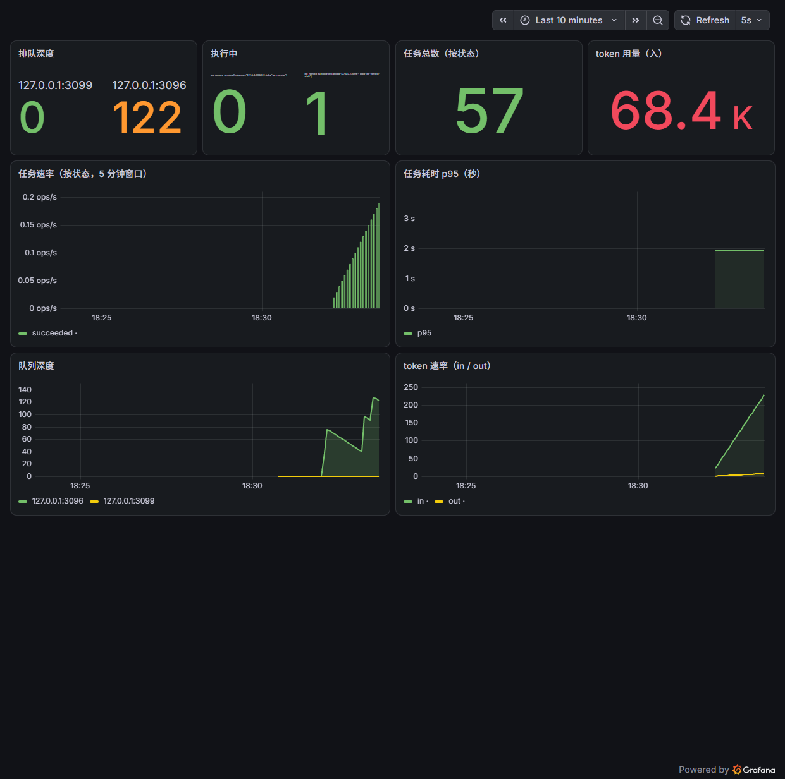

# QQ Remote Agent

用手机 QQ 遥控一台 Windows 机器：发一条消息，本机的 `claude` CLI 执行任务，结果分段发回 QQ。
还会区分「要动手」和「只是聊天」——闲聊有独立通道，顺带把单次成本压到 **1/200**。

> 语音转写、任务瘦身、表情段、连发合并这四项的实测结论参考了
> [wangpx2006/qq-agent-plugins](https://github.com/wangpx2006/qq-agent-plugins)（MIT），
> 详见文末「参考与致谢」。

```
手机 QQ ──私聊──▶ NapCat（注入 QQ NT，OneBot11 WS）
                        │ 127.0.0.1:3001
                        ▼
                  bridge.py（asyncio）
                   ├─ 意图分流 intent.classify() ──┐
                   │                                │
                   ├─ SQLite 任务队列（幂等、可恢复）│
                   │  worker pool（按工作目录加锁） │
                   │  guard.py（危险操作先要 /确认）│
                   │  panel.py（:3099 看板 + /metrics）
                   │                                │
                   │        ┌───────────────────────┘
                   ▼        ▼
        claude.exe -p     直连 /v1/messages
        （任务，全权限）    （闲聊，无工具）
                   │        │
                   └───┬────┘
                       └──▶ 按真人节奏分条回 QQ
```

## 这个项目解决的两类问题

### 一、让"远程执行"在不可靠环境里靠谱

手机上一条消息发出去，中间隔着 QQ 客户端、NapCat、WebSocket、Python 进程、
LLM API 五层，任何一层都可能断。所以整条链路是按「**假设它会断**」设计的：
队列落盘、幂等去重、发件箱补发、崩溃恢复、断线探活。

### 二、让"聊天"真的便宜、真的有上下文

这是本项目最值得看的一段工程判断，也是我踩得最深的坑。

用 `claude.exe -p` 做闲聊时，用户反馈三件事：太贵、上下文太短、不像人说话。
我没有直接调参数，而是先**把固定开销测出来**——同一句 `hi`，逐层关掉组件：

| 调用方式 | 输入 token | 相对成本 |
|---|---|---|
| `claude.exe -p`（默认） | 34,743 | 100% |
| 禁 MCP | 29,570 | 85% |
| 空 cwd + 禁 MCP + 禁工具 | 14,443 | 42% |
| **直连 `POST /v1/messages`** | **41** | **0.12%** |

结论：那 3 万 token 里 **99.8% 是 agent 框架的固定开销**（内置工具定义、MCP
工具清单、系统提示、项目级指令文件的自动注入），跟对话内容无关。

更关键的是**它和上下文策略互相恶化**：闲聊的会话上限（3 万）比这个固定开销还小，
于是每句话都触发换会话——用户感觉"上下文短"，根因是**上下文从来没被用上**。

修法不是调大上限（那只会更贵），而是**按通道换传输方式**：

| 通道 | 走什么 | 一句闲聊的成本 |
|---|---|---|
| 任务（要动电脑） | `claude.exe -p`，全权限、带工具 | 贵，但应该贵 |
| 闲聊 / 群聊陪聊 | 直连 `/v1/messages`，零工具 | **146~250 token** |
| 闲聊里发现要动手 | 模型输出 `[[做：指令]]` → 自动升级成任务 | 按需付，不是每句付 |

结果：**一句闲聊 30,301 → 146~250 token，8.5 秒 → 1.05 秒**；上下文从"每句清零"
变成 30 轮且**跨重启保留**（历史原子落盘，重启后从本地聊天记录重新垫底）。

### 三、让机器说的话像人说的

"像真人"如果靠感觉调，永远调不准。这个仓库里的做法是**拿真实聊天记录做对照统计**：
275 条真人发言 vs 机器人自己的发言，逐项量化差距，再照着数据改。

| 特征 | 真人实测 | 改造前的机器人 |
|---|---|---|
| 句末打标点 | **0%** | 63% |
| 含句号的消息 | **1%**（4/275） | 大量 |
| 完全不带任何标点 | **68%** | 几乎没有 |
| 每条字数中位 | **11 字** | 25 字 |
| 一轮发几条 | **84% 只发 1 条** | 几乎总是 2~3 条 |

其中最有价值的一条是**反直觉的**：我原以为"分条发"显得自然，数据说反了——
真人 84% 的时候只发一条，切成三句发出去正是最明显的机器特征。

## 为什么值得看

| 问题 | 做法 |
|---|---|
| 进程崩溃 / 重启，排队任务全丢？ | 队列落 SQLite，`queued` 任务重启后继续；`running` 的标成 `interrupted` 并主动通知 |
| QQ 断线重连后重投同一条消息 | `message_id` 做唯一键，重复投递直接丢弃（恰好一次执行） |
| 两个任务同时改同一个目录 | worker pool + 按 cwd 加锁，同目录串行、不同目录并行 |
| 不知道系统现在什么状态 | `/metrics`（Prometheus 文本）、`/api/state`（p50/p95、成功率）、审计 JSONL |
| 一条命令把电脑搞崩 | 危险词/危险命令识别 → 先在 QQ 里要 `/确认`，5 分钟有效 |
| 改了代码没生效 | 进程启动时间 vs 文件修改时间的自动校验（`restart-bridge.ps1`） |
| `--resume` 越聊越贵（实测单次到 205k token） | 记录真实 token；超过 `session_token_limit` 自动开新会话，启动时也会丢弃超限的旧会话 |
| **闲聊每句都在付框架的固定开销** | **按通道分流：闲聊直连 API，见上一节** |
| 想横向扩、多台机器一起消费 | `store_backend=redis`：两个进程共享队列，Lua 原子 claim，实测 40 条任务 20/20 分摊、零重复 |
| 一条命令把整台机器搞坏 | `!!` 前缀走沙箱后端（Docker/WSL），只挂载当前目录；边界写在 `ARCHITECTURE.md` |
| 陌生人打探隐私 / 在群里让它干活 | 公开通道零工具（`--tools ""`）、不注入人格与记忆；群聊只在自己被 @ 时回；只有主人私聊能执行任务 |
| 好友申请被批量利用 | 不自动同意也不自动拒绝，留在 QQ 里由主人手动处理，只提醒主人一次 |
| 不知道能扛多少 | `docs/benchmarks.md`：4 worker 跨目录 3.6 倍吞吐，同目录刻意不加速 |
| NapCat 断一下，结果就丢了 | **发件箱**：结果先落库再发送，重连后自动补发未送达的消息 |
| 长任务只有"还在执行" | **流式进度**：`stream-json` 解析工具调用，转发成 `🔧 PowerShell: …`（默认 15 秒一条） |
| 失败了不知道哪种失败 | 错误分类 `timeout / parse / cli_error / exception`，进库也进 `qq_remote_task_errors_total{kind}` |
| 号被盗会被无限刷 | 额度：每小时任务数上限 + 每日 token 上限，超限直接拒绝 |
| 数据只增不减 | 30 天保留策略（任务/事件/已送达发件箱），定期清理 + VACUUM |
| 守护只看进程在不在 | 改为探测 3001 监听 + 桥的 ESTABLISHED 连接；连续 3 次异常才重启 |
| Redis 单点挂了队列就停 | 主从 + 三哨兵：**4.6 秒选主、5.6 秒恢复写入**，数据完整 |
| agent 任务仍在本体全权限跑 | `agent_sandbox: "wsl"`：提示词写文件、`wsl -e bash -lc` 调起（需 WSL 内装 Linux 版 CLI） |
| 不知道跑久了会不会漏内存 | 10 分钟常压：内存 40→47MB 后平稳、队列不堆积、零失败（`docs/benchmarks.md` §6） |
| 每个任务都在为用不到的 MCP 和工具定义付 token | 任务默认走 `lean` 档：六个内置工具 + 空 MCP 配置；实测单次 32,470 → 18,542 输入 token（−43%），需要时 `/完整 <指令>` 临时全开 |
| 手机上发语音等于没发 | QQ 语音先落地再交给本地 faster-whisper（离线，4 秒音频约 4 秒出字），失败静默退回「没转成文字」 |
| 一句话拆成几次发，就回几次 | 连发合并：挂尾多等 6 秒、每多一条 +1 秒、上限 20 秒；命令与图片不参与合并 |
| 机器人只会打字，不会发表情 | `bridge/stickers/` 放图，模型写 `@@表情:名字@@`，bridge 用 `sub_type=1` 发出去——QQ 里显示成表情而不是大图 |


## 快速开始

```powershell
# 1) 管理员注册开机自启（计划任务 QQRemote）
powershell -ExecutionPolicy Bypass -File install-task.ps1

# 2) 启动 NapCat + 桥
.\start-all.bat

# 3) 登录 QQ：http://127.0.0.1:6099/webui  → 密码登录
# 4) 手机加机器人号为好友，发一句话即完成绑定
```

出门前：

```powershell
powershell -ExecutionPolicy Bypass -File 自检.ps1
```

## 常用命令（QQ 里发）

`/状态` `/任务 [n]` `/详情` `/停止` `/取消 <ID>` `/清空` `/确认` `/取消` `/新会话` `/日志 [n]` `/全文` `/cd <路径>` `/心跳` `/聊 <内容>` `/执行 <内容>` `/记住 <内容>` `/记忆` `/提醒 20:30 交作业` `/提醒列表` `/取消提醒 <ID>`，以及 `!<PowerShell 命令>` 直接执行。

普通消息会自动分流：像聊天的走闲聊通道（单独会话、不带任务后缀），要动手的走任务通道。

## 指标与看板

```
curl http://127.0.0.1:3099/metrics
qq_remote_tasks_total{state="succeeded"} 12
qq_remote_task_duration_seconds_bucket{le="30"} 11
qq_remote_queue_depth 0
qq_remote_tokens_total{direction="in"} 205459
```

接 Prometheus + Grafana（本机已装，`tools/monitor/start-monitoring.ps1` 一键起）：



面板包含：队列深度、执行中、任务总数、token 用量、任务速率（按状态）、p95 耗时、队列曲线、token 速率。
Prometheus 每 5 秒抓一次 `/metrics`；Grafana 用 provisioning 文件自动装配数据源与仪表盘，不用手工点。

## 测试

```powershell
pip install pytest
python -m pytest tests -q          # 243 个单测
python tests\mock_test5.py         # 端到端：假 OneBot 服务端 + 真桥
python tests\mock_new_feats.py     # 端到端：连发合并 + 语音转写（真跑 whisper）
```

覆盖面：任务状态机与幂等（store）、Redis 后端、危险命令识别（guard）、
指标（metrics）、看板 API（panel）、提醒解析、聊天分流（intent）、
上下文摘录、公开通道限流（policy）、拟人节奏与去书面化（humantype）、
直连通道（direct：历史持久化、scope 隔离、失败回滚、SSE 解析）、
表情解析与表情库扫描（stickers）、语音客户端失败边界（voice）。

端到端测试用 `QQ_REMOTE_CONFIG` / `QQ_REMOTE_STATE` / `QQ_REMOTE_DB` 指向临时文件，
监听 3002 端口，不会碰正在运行的真机 3001。

## 在聊天里调它（不用改代码）

最初想让它"像主人说话"，只能手改 `persona.md`。后来加了一层：**你直接说就行**。

```
你：现在几点
它：10:42          ← 顺便还附了一句"要不要我顺手…"
你：下次把这句话省了
它：记下了
❯ 之后每一条回复发出前，都会用代码检查这条规则
```

分两类，**判据是"能不能写成代码检查"**：

| 类型 | 触发 | 怎么生效 | 例子 |
|---|---|---|---|
| **B 类·规则** | 显式纠正 | 发出前**机械检查**，违反了就修 | 「下次别这么说」「以后别问我」 |
| **A 类·偏好** | 随口一句 | 写进记忆，注入提示词 | 「我不喜欢被追问」 |

B 类比 A 类可靠得多，因为它**不依赖模型"记得遵守"**——`rules.py` 在
`_deliver_human()` 里跑一遍，删词、砍字数、去掉结尾反问都是确定性的。

能机械判定的只有形式约束：不能出现某个词、字数上限、条数上限、不要反问收尾。
「回答温柔点」这种判不了的，只能走 A 类。

**刻意做保守的一件事**：认不准就不学。`infer_rule()` 认不出来时返回 `None`，
这句话落回记忆而不是造一条错规则。加上每天最多自动学 5 条、重复规则自动合并、
`/规则 删 <号>` 随时可撤——因为规则会影响之后**每一条**回复，错一条的代价比漏十次大。

```
/规则          看学到了哪些（带命中次数）
/规则 删 2     撤掉第 2 条
/记忆          看记住了什么
/忘 <号或词>   删一条记忆
```

## 设计取舍（为什么不做某些"更优雅"的事）

面试里最容易被追问的是"为什么这样设计"。这个仓库里有几个刻意的选择：

**1. 队列用 SQLite，不用 Redis（默认）**
单机、单用户、串行执行。Redis 会引入一个要运维的常驻服务，而 SQLite 的事务 +
WAL 已经够做幂等认领和崩溃恢复。Redis 后端保留了（`store_backend=redis`），
但它解决的是**另一个**问题——多进程/多机共享队列，不是"更好"。

**2. 同目录任务刻意串行**
两个 agent 同时改同一棵目录，结果不可预测。所以按 `cwd` 加锁，宁可牺牲并行度。
压测里"跨目录 4 worker 3.6 倍吞吐、同目录不加速"就是这条的代价，写进 README 而不是藏起来。

**3. 闲聊不用 agent 框架**
不是因为"框架不好"，而是因为它携带的固定开销（工具定义 + MCP + 项目指令）
在闲聊场景占 99.8%。任务通道仍然用它——那里需要工具和权限，贵是对的。
**按场景选传输方式，而不是全场统一。**

**4. 拟人化不追求"人设"，追求统计一致**
没有去堆形容词，而是拿 275 条真实发言算分布，照着改。而且明确记下了一条
**反直觉的负面结论**：我以为分条像人，数据显示真人 84% 只发一条。
把错的结论也留在文档里，比只写成果更接近真实工程。

**5. 安全边界做在启动参数上，不靠提示词**
公开通道用 `--tools ""` 直接拿掉能力，而不是在提示词里写"请不要执行命令"。
提示词能被注入绕过，`--tools ""` 不能。

## 安全模型（务必读）

桥以 `--dangerously-skip-permissions` 运行，**等于本人坐在电脑前的完整权限**。
唯一防线是 `owner_uin` 白名单 + 危险操作确认 + 全量审计。
`guard.py` 是**人工确认**，不是沙箱；真要隔离得上 Docker / WSL / 受限令牌。

## 文档

- `ARCHITECTURE.md` —— 架构与决策记录（ADR）：模块边界、状态机、安全模型、为什么这样取舍
- `docs/benchmarks.md` —— 压测与常压数据（吞吐、延迟、内存、Redis 故障切换）
- `使用说明.md` —— 面向使用者的操作指南

## 聊天框里的"TUI 手感"

| TUI 里的东西 | 这里怎么对应 |
|---|---|
| 边生成边显示 | `--include-partial-messages` 解析文本增量，按标点/80 字/1.5 秒合并后逐条发到 QQ |
| 工具调用过程 | `🔧 Bash: find /mnt/c/...`（默认 15 秒一条，避免刷屏） |
| 状态栏 | 每条结果末尾附加 `⏱ 8.2s · 29k→154 tok` |
| markdown 渲染 | QQ 不渲染，自动去围栏/加粗/标题，保留正文 |
| `/model` `/cost` `/compact` 类命令 | `/model <名称>`、`/cost`、`/状态`、`/详情`、`/任务`、`/停止`、`/清空`、`/提醒` |

实测一条任务的 QQ 侧表现：先出现若干段文本增量，最后一条是 `✅ 完整结果 + 耗时/token 状态行`。

## 参考与致谢

部分能力的**实测结论与做法**来自 [wangpx2006/qq-agent-plugins](https://github.com/wangpx2006/qq-agent-plugins)
（MIT 许可，JS 实现的一组 QQ-agent 插件）。本项目只取可迁移的经验，代码按 Python/asyncio
的结构重写，没有搬它的架构（它没有队列/指标/看板，本项目这些是自有部分）：

| 借来的东西 | 在本项目里的落点 |
|---|---|
| `claude -p` 固定开销实测（53,948 → 12,986），以及"限工具 + 空 MCP"的瘦身思路 | `bridge/bridge.py` 的 `task_profile=lean`：六工具 + `--strict-mcp-config`，实测 −43% |
| 语音消息的识别链路与"失败静默退回"策略 | `bridge/asr_server.py`、`bridge/voice.py`（改为本地 faster-whisper 常驻） |
| QQ 图片段靠 `sub_type` 区分图片(0)/表情(1) | `bridge/stickers.py`，模型写 `@@表情:名字@@` |
| 连发消息合并的窗口思路 | `bridge.py` 的 `_merge_append/_merge_flush`（窗口参数按本机实测重调） |

上游仓库：<https://github.com/wangpx2006/qq-agent-plugins>（MIT）。
如果这些做法对你有用，请也给上游点个 star。

## 说明

- 本项目是个人自用工具，文档里的路径按 `C:\Users\<user>\qq-remote` 组织。
- 任务瘦身、语音转写、表情段 `sub_type`、连发合并这四件事的实测结论来自
  [wangpx2006/qq-agent-plugins](https://github.com/wangpx2006/qq-agent-plugins)（MIT），
  本项目按 Python/asyncio 的结构重写，不是直接搬代码。
- 仓库内不含任何 token / QQ 号 / 密码；`bridge/config.json` 已在 `.gitignore` 中，
  首次使用请从 `bridge/config.example.json` 复制并填入自己的值。
- NapCat 属于第三方项目，不在本仓库内（`napcat/` 已忽略），需自行下载。
